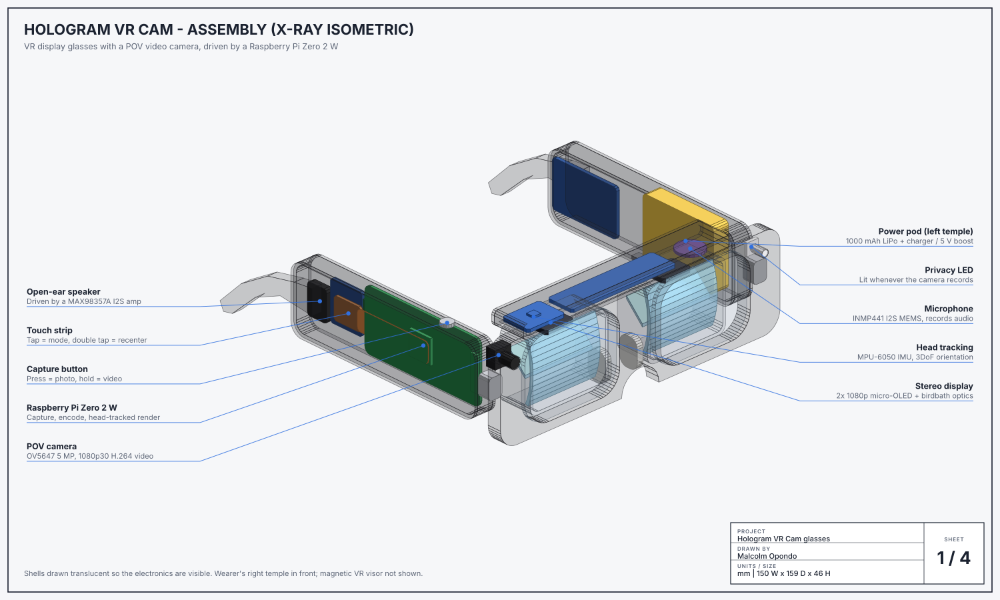
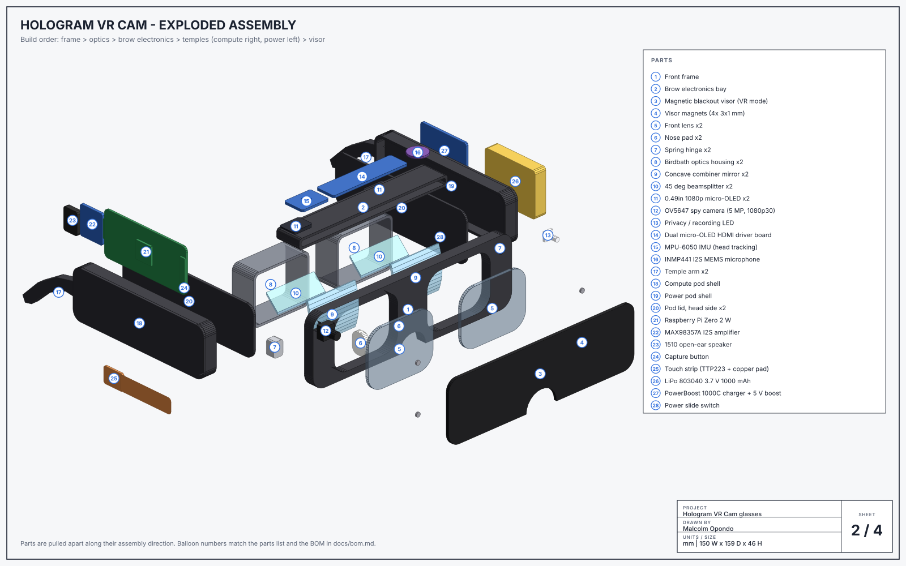
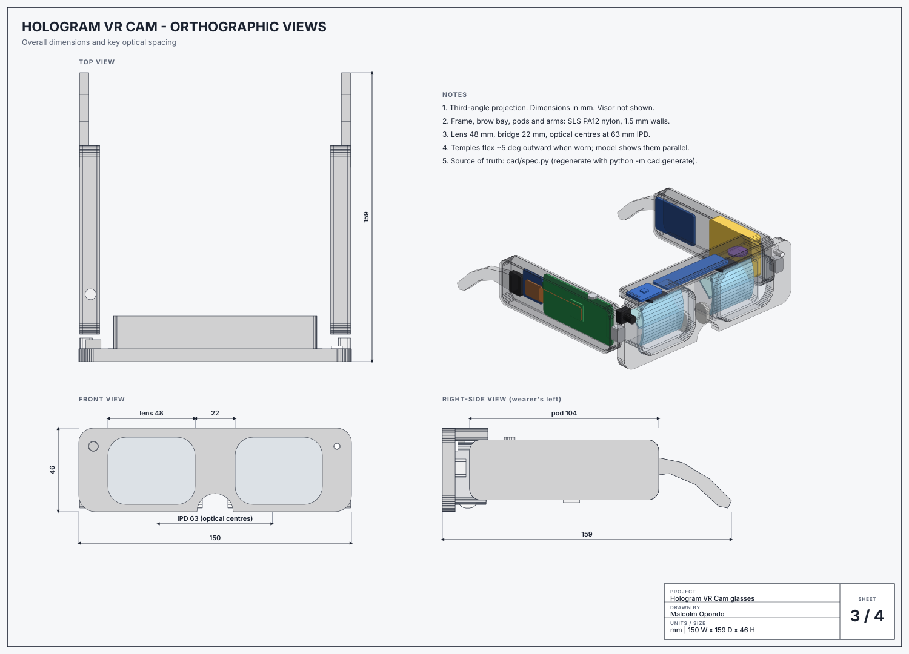
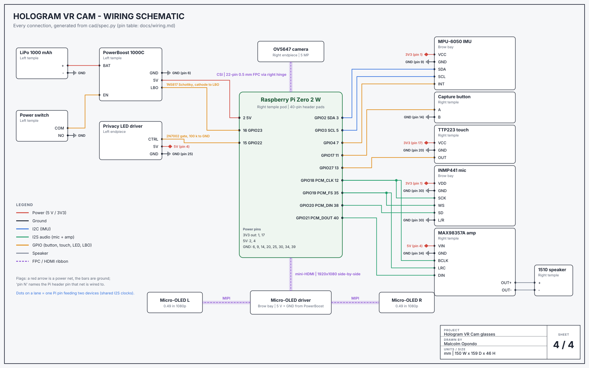
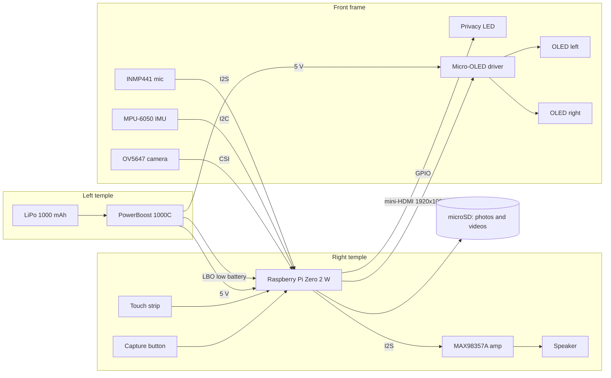

# Hologram VR Cam

DIY glasses that work as a **VR / AR headset** and a **Ray-Ban-style POV camera**. Press the button on the
temple to take a photo, hold it to record video with sound, and look through two 1080p micro-OLED displays at
a head-tracked 360° scene or the live camera feed.

This repo has everything needed to build them:

- a **Revit model** (an IFC file Revit opens directly, plus a pyRevit script that builds a native family),
- **drawings**: x-ray assembly, exploded view, orthographic views with dimensions, and the wiring schematic,
- a **bill of materials**, pin-by-pin **wiring table** and step-by-step **build guide**,
- the **software** that runs on the glasses (Python, Raspberry Pi Zero 2 W), with tests.



## What it does

| | |
|---|---|
| **Video** | 1080p30 H.264 with AAC audio from an I2S microphone. 60 s clips by default (configurable), saved to microSD |
| **Photos** | 5 MP stills (1080p while a video is recording) |
| **Privacy LED** | Lit for the whole recording. The software turns it on *before* the encoder starts and refuses to record if the LED driver fails |
| **VR** | Side-by-side stereo on 2x 0.49" 1920x1080 micro-OLEDs through birdbath optics (~45° FOV). 3DoF head tracking with an MPU-6050 and a Madgwick filter |
| **Modes** | 360° panorama viewer, camera passthrough, or display off (camera-only glasses like Ray-Ban Meta) |
| **AR / VR switch** | Birdbath optics are see-through. Snap on the magnetic blackout visor for full immersion |
| **Safety** | Stops recording when the SoC overheats, warns when storage is full, saves the clip and shuts down on low battery |

**Honest expectations:** this is a prototype built from hobby parts. A Raspberry Pi Zero 2 W replaces Meta's
custom chip, so the temples carry 33 mm-tall pods and the frame is chunkier than a Wayfarer. Field of view is
like XREAL-style display glasses (~45°), not a Quest-class headset. Battery life is roughly an hour of mixed use.

## Repository layout

```
cad/                    the 3D model and everything generated from it
  spec.py               single source of truth: geometry, materials, BOM, wiring
  generate.py           python -m cad.generate -> IFC, Revit JSON, drawings, docs
  out/hologram_glasses.ifc        open in Revit (File > Open > IFC)
  out/stl/              printable frame parts
  revit/build_hologram_glasses.py pyRevit / RevitPythonShell family builder
docs/
  drawings/             01 assembly, 02 exploded, 03 orthographic, 04 wiring (SVG)
  assembly.md           build guide
  bom.md, wiring.md     generated parts list and pin table
hologram/               glasses software (capture, tracking, stereo renderer, app)
config/hologram.toml    every setting, with defaults
deploy/                 Pi setup script and systemd service
tests/                  pytest suite (software + CAD consistency + IFC validation)
```

## The Revit model

The model has 37 parts (frame, optics, every electronic module, the battery and hardware), all built from
extrusions, so it maps 1:1 onto Revit geometry. Two ways in:

**Option A: open the IFC (quickest).** In Revit: *File > Open > IFC*, pick `cad/out/hologram_glasses.ifc`.
Every part comes in as its own element with name, material and colour. The file is valid IFC4 (checked by the
test suite with ifcopenshell, including the IFC schema rules).

**Option B: build a native family (editable).**

1. *File > New > Family* and choose **Metric Generic Model.rft**.
2. Run `cad/revit/build_hologram_glasses.py` with [pyRevit](https://github.com/pyrevitlabs/pyRevit)
   or RevitPythonShell. It reads `hologram_glasses_model.json` from the same folder.
3. It creates every part as solid extrusions, one subcategory and material per finish (so you can colour or
   hide the frame, PCBs, optics...), and a model group per part.
4. Save as `HologramVRCam.rfa` and load it into a project.

The script targets Revit 2019+ and runs under both IronPython 2.7 and CPython 3. I could not run it inside Revit
here, so if your Revit version complains, the error message names the part that failed. The IFC route doesn't
depend on the script.

Units are millimetres. Axes: X = wearer's right, Y = forward, Z = up. The origin is the centre of the bridge.

## Drawings

| | |
|---|---|
|  |  |
| **02 Exploded assembly**: numbered parts + build order | **03 Orthographic**: 150 W x 159 D x 46 H mm, lens 48 / bridge 22, IPD 63 |



## How it works



Software, per frame on the Pi:

1. **Inputs** (GPIO edges) go to `GestureDetector`, which turns them into tap / double tap / hold.
2. **Capture** (`CaptureController`) applies the rules: LED first, clip-length cap, thermal and storage guards,
   low battery. Picamera2 does the hardware H.264 encode, and ffmpeg muxes in the microphone audio.
3. **Tracking** runs in its own thread at 200 Hz: MPU-6050, then gyro-bias calibration, then the Madgwick
   filter, with a yaw recentre on double tap.
4. **Rendering**: per-eye sample grids (with optional barrel pre-distortion) are computed once at start-up. Each
   frame only rotates those rays into the 360° image, or gathers camera pixels for passthrough. The result goes
   out as one side-by-side 1920x1080 frame, which the driver board splits between the eyes.

## Install on the glasses

On Raspberry Pi OS Lite (64-bit):

```bash
git clone https://github.com/s-rakim/hologram-vr-cam.git
cd hologram-vr-cam
./deploy/setup_pi.sh     # packages, I2C/I2S overlays, HDMI mode, systemd service
sudo reboot
```

Settings live in [`config/hologram.toml`](config/hologram.toml) (pins, clip length, FOV, lens distortion, IMU
axes, thermal limits).

| Control | Action |
|---------|--------|
| Capture button: tap | Photo, or stop recording |
| Capture button: hold | Start video |
| Touch strip: tap | Next mode: 360 view, passthrough, display off |
| Touch strip: double tap | Recentre the view |
| Touch strip: hold | Display sleep / wake |

## Try it on a computer

```bash
pip install numpy
python -m hologram demo                          # headless walk-through with mock hardware
python -m hologram snapshot --yaw 30 --pitch 10  # render one stereo frame to PNG
pip install pygame && python -m hologram run --mock --window   # SPACE = button, T = touch, ESC = quit
```

## Development

```bash
pip install -e ".[dev]"
pytest                      # software, CAD consistency, IFC4 validation
python -m cad.generate      # after editing cad/spec.py: rebuild IFC, Revit JSON, drawings, BOM, wiring
python -m cad.stl_export    # rebuild the printable STLs (needs ifcopenshell)
```

The tests check that the software's default GPIO pins match the wiring in the CAD spec, that every edge in the
model is long enough for Revit (above its ~0.8 mm short-curve tolerance), and that the generated files are up
to date.

## Build it

Start with **[docs/assembly.md](docs/assembly.md)**: printing and drilling, bench testing, frame, optics,
temples, hinge harness, calibration. Parts are in **[docs/bom.md](docs/bom.md)** and every connection is in
**[docs/wiring.md](docs/wiring.md)**.
