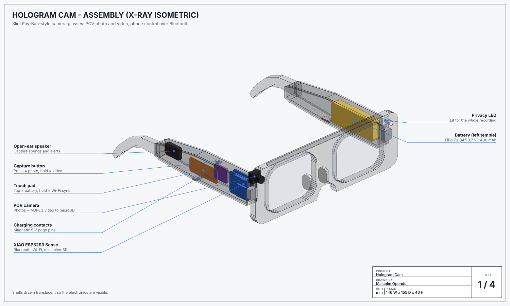
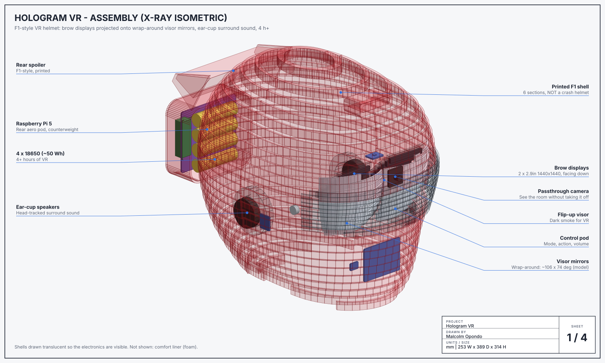

# Hologram

Two DIY wearables, each designed as its own device:

| | **Hologram Cam**: camera glasses | **Hologram VR**: VR helmet |
|---|---|---|
| Looks like | Ordinary Ray-Ban-style glasses | A Formula 1 racing helmet |
| Does | Photos and long videos with sound, controlled from your phone | Wide-angle head-tracked VR with surround sound through the ear cups |
| Brain | Seeed XIAO ESP32-S3 Sense (firmware in C++) | Raspberry Pi 5 (Python) |
| Storage | microSD, video split into 5-minute files | microSD |
| Control | Button + touch pad on the temple, **Bluetooth phone app** | Four buttons on the chin bar |
| Battery (estimates) | ~400 mAh LiPo in the left temple: about 4-5 h of mixed use | 4 x 18650 (~50 Wh) in the rear pod: about 4.3-4.8 h of VR |

Both are in this repo with everything needed to build them: a **Revit model** (IFC files Revit opens directly, plus a
pyRevit script that builds native families), **drawings** (x-ray assembly, exploded view, dimensioned orthographic
views, wiring schematic), **printable STLs**, a **bill of materials**, a pin-by-pin **wiring table**, a **build guide**,
and the **firmware/software** with tests.

> **The helmet is not a crash helmet.** It is a printed enclosure for a VR headset, it blocks your view, and it must
> never be worn while riding, driving, cycling or walking around.

## Hologram Cam: the glasses



A slim frame (146 mm wide, 12 mm temples) with the whole computer, a XIAO ESP32-S3 Sense, inside the right temple and
the battery in the left one. There is no display; you control it with the button and the touch pad, or from your
phone over Bluetooth.

| | |
|---|---|
| **Video** | MJPEG up to 1600 x 1200 (1280 x 720 recommended for a smoother frame rate) with 16 kHz mono sound, saved as AVI files on the microSD card. Long recordings roll over into a new file every 5 minutes (adjustable), so there is no 4 GB FAT32 limit and a crash loses at most one segment. Recording runs until you stop it (or set a maximum), the card fills, the battery runs low, or the chip gets too hot |
| **Photos** | Up to 1600 x 1200 JPEG (the stock 2 MP OV2640; an OV5640 also works, at the same size) |
| **Privacy LED** | The firmware switches the front LED on *before* every photo and video, and refuses to capture if the LED control pin is held low (a shorted driver). It can't see a broken LED or wire, so check that it lights. Keep it visible |
| **Phone app** | [`phone/index.html`](phone/index.html), a Web Bluetooth page: photo, record, live status (battery, recording time, card space left), settings, find-my-glasses beep, power off. Pairing needs a 6-digit passkey |
| **Getting files off** | Double-tap the touch pad (or tap *Wi-Fi sync* in the app): the glasses start a Wi-Fi hotspot with a random password, and a web page there lists, downloads and deletes your files. Firmware updates go through the same page |

| Control on the glasses | Action |
|---|---|
| Capture button: tap | Photo, or stop recording |
| Capture button: hold | Start recording |
| Touch pad: tap | Battery level (1-4 beeps) |
| Touch pad: double tap | Wi-Fi sync on/off |
| Touch pad: hold 3 s | Power off (the capture button wakes it) |

**Honest expectations:** the ESP32-S3 records about 720p MJPEG at roughly 10-15 fps. Ray-Ban Meta's custom chip
records much higher quality video, so this is the open, hackable version, not a match for it. iPhone users need the
free [Bluefy](https://apps.apple.com/app/id1492822055) browser for the phone app, because
Safari has no Web Bluetooth. Chrome on Android and desktop works as it is.

Build guide: **[docs/cam/assembly.md](docs/cam/assembly.md)**, parts in [docs/cam/bom.md](docs/cam/bom.md), wiring in
[docs/cam/wiring.md](docs/cam/wiring.md), phone protocol in [docs/cam/ble-protocol.md](docs/cam/ble-protocol.md).

## Hologram VR: the F1 helmet



The shell is shaped like a closed-face F1 helmet: narrow eye slot, forward chin bar, long tail with a rear spoiler, and
a top air intake. It prints in six sections that each fit a 256 mm printer.

**How the picture reaches your eyes (the projector part).** Two 2.9-inch 1440 x 1440 panels sit in the brow, above your
eyes, facing down. Each projects its picture onto a curved mirror in the visor, which reflects a magnified, distant
image back into the eye. This is the reflector-optics idea behind wide-angle headsets such as Project North Star. Each
mirror is a patch of an ellipsoid with one focus at your eye, so the software can ray-trace exactly where every pixel
appears and pre-warp the image to match. The mirrors wrap around the face, so the view is much wider than one flat
panel behind a lens gives you.

| | |
|---|---|
| **Field of view** | **~106° horizontal x 74° vertical** across both eyes, with 50° of stereo overlap, ray-traced from the model (`python -m hologram.vr optics`). Treat it as an upper bound: the edges will be softer than the centre, and North Star builders measure well below that design's own claims |
| **Sound** | The closed ear cups carry 40 mm drivers on two I2S amps. A 360 photo `beach.jpg` with a `beach.wav` beside it plays that sound *around* you, fixed to the scene: turn your head and the sound stays where it belongs. 4-channel ambisonic (AmbiX), stereo and mono files all work |
| **Modes** | 360 photo viewer; gallery (photos from the glasses on a big virtual screen); camera passthrough (Camera Module 3 Wide, mapped to the true directions so the room looks the right size) |
| **Tracking** | MPU-6050 at 200 Hz with a Madgwick filter (3DoF). Hold the action button to recentre |
| **Power** | Pi 5 on a 4 x 18650 UPS board in the rear aero pod, which also counterweights the optics. The displays switch off when the helmet is put down, and a still view is not re-rendered. It warns at 10 % and shuts down cleanly at 3 % |

| Button (control pod on the left of the chin bar) | Action |
|---|---|
| Mode: tap / hold 2 s | Next mode / power off |
| Action: tap / hold | Next photo or panorama / recentre the view |
| Volume - / + | Ear-cup volume |

Build guide: **[docs/vr/assembly.md](docs/vr/assembly.md)**, parts in [docs/vr/bom.md](docs/vr/bom.md), wiring in
[docs/vr/wiring.md](docs/vr/wiring.md). How the 4-hour battery figures were worked out: [docs/battery.md](docs/battery.md).

## The Revit model

Each product is its own model, built from extrusions so it maps 1:1 onto Revit geometry. The curved helmet shell,
visor and mirrors are stepped slices of the real surfaces; the STL files carry the smooth versions.

- **Open the IFC (quickest):** in Revit, *File > Open > IFC*, then pick `cad/out/cam/hologram_cam.ifc` or
  `cad/out/vr/hologram_vr.ifc`. Every part comes in as its own element with name, material and colour. Both files are
  valid IFC4; the tests check them with ifcopenshell, including the schema rules.
- **Build a native family (editable):** *File > New > Family > Metric Generic Model*, then run
  `cad/revit/build_hologram_family.py` with [pyRevit](https://github.com/pyrevitlabs/pyRevit) or RevitPythonShell. It
  asks which product to build (it reads `cad/revit/hologram_<product>_model.json`) and creates every part as solid
  extrusions, with one subcategory and material per finish.

The script targets Revit 2019+ under IronPython 2.7 or CPython 3. I could not run it inside Revit here, so if your
version complains, the error names the part that failed. The IFC route doesn't depend on the script. Units are mm;
X = wearer's right, Y = forward, Z = up.

| Drawing | Cam | VR |
|---|---|---|
| 01 Assembly (x-ray) | [svg](docs/cam/drawings/01_assembly.svg) | [svg](docs/vr/drawings/01_assembly.svg) |
| 02 Exploded + build order | [svg](docs/cam/drawings/02_exploded.svg) | [svg](docs/vr/drawings/02_exploded.svg) |
| 03 Orthographic + dimensions | [svg](docs/cam/drawings/03_orthographic.svg) | [svg](docs/vr/drawings/03_orthographic.svg) |
| 04 Wiring schematic | [svg](docs/cam/drawings/04_wiring.svg) | [svg](docs/vr/drawings/04_wiring.svg) |

## Repository layout

```
cad/
  products/cam.py, vr.py   the two models: geometry, materials, BOM, wiring, drawing notes
  helmet.py                F1 shell surface, printable sections, smooth meshes
  generate.py              python -m cad.generate  -> IFC, Revit JSON, drawings, BOM, wiring tables
  stl_export.py            python -m cad.stl_export -> cad/out/<product>/stl/*.stl
  out/<product>/           IFC model + printable STLs
  revit/                   pyRevit family builder + model JSON
firmware/glasses/          PlatformIO project for the XIAO ESP32-S3 Sense (C++)
phone/                     Web Bluetooth phone app for the glasses (published to GitHub Pages)
hologram/                  helmet software (Python): optics, renderer, spatial audio, tracking, app
config/vr.toml             every helmet setting, with defaults
deploy/                    Pi 5 setup script + systemd service
docs/                      per-product drawings, BOM, wiring, build guides; battery analysis
tests/                     pytest: CAD, IFC, meshes, optics, firmware core, helmet app
```

## Software quick start

**Glasses firmware** (PlatformIO):

```bash
cd firmware/glasses
pio run -t upload            # first flash over USB-C; later updates over Wi-Fi sync
```

Change `BLE_PASSKEY` in `firmware/glasses/include/config.h` before you flash.

**Phone app:** publish `phone/` with GitHub Pages. First enable *Settings > Pages > Source: GitHub Actions*, then run
the *Phone app* workflow from the Actions tab (it also re-runs by itself whenever `phone/` changes on `main`). Open the
page in Chrome (Android/desktop) or Bluefy (iOS).

**Helmet** on Raspberry Pi OS Lite (64-bit, Bookworm):

```bash
git clone https://github.com/s-rakim/hologram-vr-cam.git && cd hologram-vr-cam
./deploy/setup_pi5.sh && sudo reboot
```

**Try the helmet software on a computer** (Python 3.11 or newer):

```bash
pip install numpy
python -m hologram.vr optics                     # field of view of the optics
python -m hologram.vr demo                       # headless walk-through on mock hardware
python -m hologram.vr snapshot --yaw 30          # one pre-warped stereo frame to PNG
pip install pygame pillow && python -m hologram.vr run --mock --window   # M, SPACE, -/= keys
```

## Development

```bash
pip install -e ".[dev]"
pytest                    # CAD + IFC4 validation, meshes, optics, firmware core (needs g++), helmet app
ruff check .
python -m cad.generate    # after editing cad/products/*.py or cad/helmet.py
python -m cad.stl_export
```

The tests check, among other things, that the firmware's and the helmet software's pins match the CAD wiring, that the
helmet's mirrors and panels fit inside the shell and clear the face, that every printed mesh is watertight and fits a
256 mm bed, that the Revit edges are above Revit's short-curve tolerance, and that the generated files are up to date.
