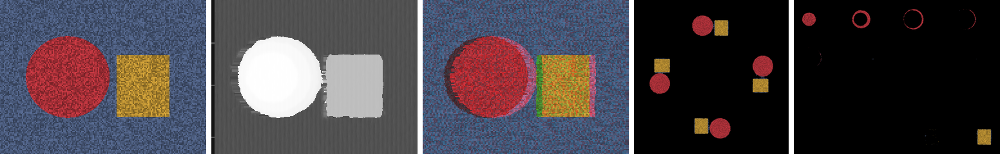
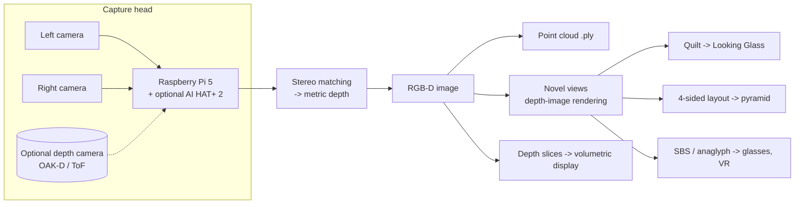

# The Hologram Machine

A capture-to-display rig that photographs a subject in 3D and plays it back as a "hologram": an image
with real depth that floats in space or changes as you move around it. The software is the
[`holomaker`](../holomaker) package in this repo. This page covers the hardware and how to use it.

**What kind of "hologram" this is.** A true hologram reconstructs the light field with laser
interference (see [True holography](#5-true-holography-research-route) below). That route still means lab
optics and a research budget. This machine uses the four practical routes instead. Each gives a
convincing 3D image, and all four are fed from the same capture:

| Display | What the viewer sees | Cost | Output from `holomaker` |
|---|---|---|---|
| Pepper's-ghost pyramid on a phone / tablet / monitor | Subject floating inside a clear pyramid, visible from 4 sides | ~$5 + a screen you own | `*_pyramid.png` |
| Light field display (Looking Glass) | Glasses-free 3D with smooth parallax for several viewers | $300 (Go) up to $8,000-10,000 (27" 5K) | `*_qs8x6a1.33.png` quilt |
| Swept-volume volumetric display (DIY) | Points of light inside a real volume, walk-around | DIY: projector + mechanics | `*_slices/` |
| VR headset / the Hologram VR Cam glasses / 3D TV | Stereo depth | already in this repo | `*_sbs.png` |
| Red/cyan glasses | Stereo depth, any screen | <$5 | `*_anaglyph.png` |



*`python -m holomaker demo`: input photo, recovered depth (near = bright), red/cyan anaglyph, pyramid layout with the back wall removed, and 16 depth slices (the ball appears as rings, near to far).*

Every run also writes a coloured **point cloud** (`.ply`) for Blender, MeshLab, CloudCompare, Unity or
three.js, plus the metric depth map (`*_depth_m.npy`).



## 1. Capture head

Pick one. All of them end up as the same RGB-D image, so the displays don't care which you chose.

### Option A: two Pi cameras on a Raspberry Pi 5 (cheapest, still subjects)

The Pi 5 has two camera connectors, so two identical camera modules can run at once.

| Part | Notes |
|---|---|
| Raspberry Pi 5 (4 or 8 GB) + 27 W USB-C supply | Stereo matching is CPU-bound; 8 GB leaves room for the AI HAT |
| 2x Raspberry Pi Camera Module 3 (same lens version) | Must be identical: same sensor, lens and focus |
| 2x Pi 5 camera cables (22-to-15 pin, 200 mm) | |
| Stereo bar: 3 mm aluminium flat bar, 120 mm, or a 3D-printed bracket | Lens centres **63 mm** apart (human eye spacing). Rigid, so the pair stays aligned |
| M2 screws + nylon spacers | |
| Tripod with 1/4"-20 mount | |

Limits: Picamera2 opens the two ports separately, so the sensors are **not frame-synchronised**. Raspberry
Pi forum posts note that running two cameras in separate processes means there is no way to synchronise
framing or auto-exposure between them. That is fine for subjects that hold still (people posing,
objects, products). `capture_pair()` lets you fix exposure and gain, which stops the two auto-exposure
loops drifting apart.

### Option B: hardware-synchronised stereo kit (moving subjects)

The **Arducam 2.3MP x2 AR0234 global-shutter stereo kit** (listed at $259.99, Pi 5 compatible) gives
genuinely synchronised frames. Global shutters also avoid rolling-shutter skew. Modes include 2560x720 at
94 fps. The cameras sit on separate boards, so you choose the baseline. Pi 5 support needs the current
Raspberry Pi OS and Arducam's `arducam-pivariety` driver. The two views arrive side by side in one frame:
split it down the middle and pass the halves to `holomaker stereo`.

### Option C: a depth camera (depth computed for you)

A **Luxonis OAK-D Lite** computes stereo depth on the camera itself: 75 mm baseline, ideal range 40 cm
to 8 m, vendor-stated error under 2% up to 3 m, one USB-C cable. Retail prices run from about $149 to
$269. Save its aligned colour frame and depth (metres) as a PNG and an `.npy`, then run
`holomaker rgbd`.

Other depth sensors were checked and rejected as the main sensor:

* **Arducam ToF camera**: 240x180 depth, 2-4 m range, about $30-50. Too coarse for a good-looking
  hologram, but fine for robotics.
* **ST VL53L8CX**: 8x8 zones, 4 m range in the dark. Only useful as a scale reference.
* **Intel RealSense D4xx**: still sold. RealSense was spun out of Intel in 2025 and in September 2026
  agreed to be bought by Cognex, so the long-term SDK direction is unclear.

### Option D (add-on): AI depth from a single camera

The **Raspberry Pi AI HAT+ 2** (Hailo-10H, 40 TOPS INT4, $130 list) or the older AI HAT+ can run
**Depth Anything V2 Small**. Seeed publishes a ready Hailo build at 224x224. The Small checkpoint is
Apache-2.0; the larger checkpoints are non-commercial. This gives depth from one camera at video rate, but
the depth is *relative*, not in metres. Scale it before saving the `.npy`: measure one known distance, or
anchor it with a VL53L8CX reading. Use this route for video holograms, and stereo for stills that need
true metric depth.

## 2. Displays

### 1. Pepper's-ghost pyramid (build this first)

The cheapest display that reads as a "hologram". A clear four-sided pyramid stands **small end down**
on the middle of a screen. Each face is at 45°, so it reflects the image on its side of the screen up
into the pyramid. `holomaker` writes the four-sided layout, with each copy's top pointing outwards so
every viewer sees it upright and not mirrored. The left and right faces show views rendered from
either side, so the subject turns slightly as you walk around it.

**Cutting the faces.** For a layout `S` pixels square shown at physical width `W` mm, the empty centre
square is `c = W / 3` mm. Cut four identical trapezoids from 0.5-1 mm clear PETG or acrylic:

| Edge | Length |
|---|---|
| Short (bottom) edge | `c` |
| Long (top) edge | `3c` |
| Height of the trapezoid, measured on the face | `c * 1.414` |
| Slanted sides | `c * 1.732` |

Example: a tablet showing the layout 150 mm wide gives `c` = 50 mm. Cut 50 mm / 150 mm trapezoids,
71 mm tall, with 87 mm sides. Tape the slanted edges together with clear tape on the inside.

**Background is everything.** Black pixels are invisible in the reflection, so the subject floats only
if its background is black. Use `--subject-depth` (in metres) to remove everything behind the subject,
shoot against black cloth, and run the room dark with the screen at full brightness.

### 2. Light field display (Looking Glass)

Looking Glass displays show 45-100 views at once across a viewing cone (53° on the 27" 5K). `holomaker`
renders a sweep of views from the RGB-D image and packs them into a **quilt**: view 0 is the leftmost
camera, starting in the bottom-left tile. The file name carries `_qs{cols}x{rows}a{aspect}` so Looking
Glass software detects the layout. The default is 8x6 (48 views). Set `--quilt` to your device's preferred
layout and `--span-mm` to how far the virtual camera should travel; 80-150 mm suits a subject 1 m away.

Prices from 2025 coverage: Looking Glass Go $300; 16" around $4,000; 27" 5K $8,000 pre-order, then
$10,000. Its newer "Hololuminescent" line reportedly starts around $1,500, but I found only one source
for that figure.

### 3. Swept-volume volumetric display (DIY)

A screen moves rapidly back and forth through a volume while a projector shows the cross-section for
each position. Persistence of vision merges the cross-sections into a solid 3D image you can walk around.
Voxon's commercial VX1 works this way: a high-speed DLP projector synchronised to a reciprocating screen,
about 20 Hz in their patent. Hobby builds use a projector with its colour wheel removed plus a fast LCD
shutter, or spin an LED panel.

`holomaker` writes the slices (`--slices N`, near to far) plus a contact sheet, and `hologram.json`
records each slice's depth band. Budget the frame rate first: `N` slices x 20 Hz sweep x 2 (out and back)
means 16 slices already needs **640 fps**. That is why these builds use DLP binary or monochrome modes.

### 4. Stereo: the Hologram VR Cam glasses, VR headsets, 3D TVs

`*_sbs.png` is left | right at full width each. The glasses in this repo take side-by-side frames, and
VR players do too. To upload stereo video to YouTube, mark it with the Spatial Media Metadata Injector
(`-s left-right`), or add an `st3d` box with FFmpeg. Apple Vision Pro wants MV-HEVC. FFmpeg 7.1
can decode MV-HEVC, but I found no open-source encoder, so use Apple's Compressor or a commercial SDK.

### 5. True holography (research route)

A computer-generated hologram on a phase-only spatial light modulator (SLM) lit by a laser reconstructs
real wavefronts. It is a research bench, not a build: lab SLMs cost thousands; laser coherence causes
speckle, and LEDs blur the image instead; and fast SLMs have very coarse phase steps that need
special optimisation. Some university labs now use low-cost phase SLMs. If you go this way, the
`*_slices` output is a natural input for layer-based hologram algorithms such as Gerchberg-Saxton per
depth plane.

## 3. Using it

```bash
pip install -e .
python -m holomaker demo --out out/demo                   # synthetic scene, checks depth against ground truth

# On the Pi 5 with two cameras (Option A):
python -m holomaker capture --out out/shot1 --subject-depth 1.5

# From any rectified stereo pair (Option B, a phone stereo app, two photos taken 63 mm apart...):
python -m holomaker stereo left.jpg right.jpg --baseline-mm 63 --hfov 66 --out out/pair

# From a photo plus a depth map in metres (Option C/D):
python -m holomaker rgbd photo.png depth.npy --hfov 69 --out out/rgbd
```

| Flag | Default | Meaning |
|---|---|---|
| `--hfov` | 66 | Horizontal field of view of the camera, degrees. Camera Module 3 standard is 66, wide is 102 |
| `--baseline-mm` | 63 | Distance between the two lens centres |
| `--max-disp` | 64 | Largest pixel shift searched. Raise it if close objects come out wrong: nearest depth = `fx * baseline / max_disp` |
| `--subject-depth` | none | Black out everything farther than this (metres). Used by the pyramid, slices and point cloud |
| `--quilt C R` | 8 6 | Light field quilt layout |
| `--span-mm` | 120 | Virtual camera travel across the quilt views |
| `--slices` | 16 | Volumetric slices |
| `--stem` | hologram | Output file prefix |

Outputs, all in `--out`: `*_image.png`, `*_depth.png` (preview), `*_depth_m.npy`, `*.ply`, `*_sbs.png`,
`*_anaglyph.png`, `*_qs…png`, `*_pyramid.png`, `*_slices/slice_NNN.png`, `*_slices.png` and `*.json` (settings,
statistics, slice depths and file list).

**Getting good depth from stereo**

* The pair must be **rectified**: the same object sits on the same row in both images. A rigid bar does
  most of the work. If rows are off by more than 1-2 px, calibrate with a chessboard (OpenCV
  `stereoCalibrate` + `stereoRectify`) and rectify first.
* Texture matters: plain walls and sky can't be matched and are filled from the background.
* Work at 640-1280 px wide. The numpy matcher takes seconds per frame on a Pi 5, which is fine for stills.
  For live video use Option C or D.
* Depth precision drops with distance squared. With a 63 mm baseline, keep the subject within about
  0.5-3 m. Widen the baseline for farther subjects.

## 4. Known limits

* One RGB-D image only knows the surfaces its camera saw. The pyramid's side and back faces and the
  light field views are re-renderings of the front view with parallax, not true side and back views. For
  true 360°, capture from four sides (or more) and merge the point clouds, or use multi-view
  reconstruction / Gaussian splatting. Streaming Gaussian-splat video is still an active research area
  with no standard format yet.
* Holes that open behind foreground objects are filled from the background, so thin edges can smear
  slightly.
* None of these is a true optical hologram; see section 2.5.

Sources for every figure on this page are in [research/3d-visual-output.md](research/3d-visual-output.md).
